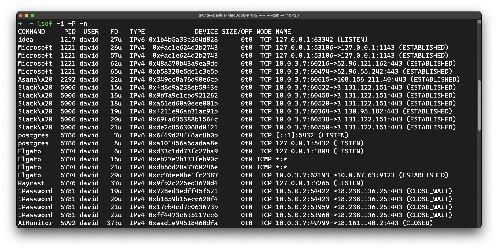
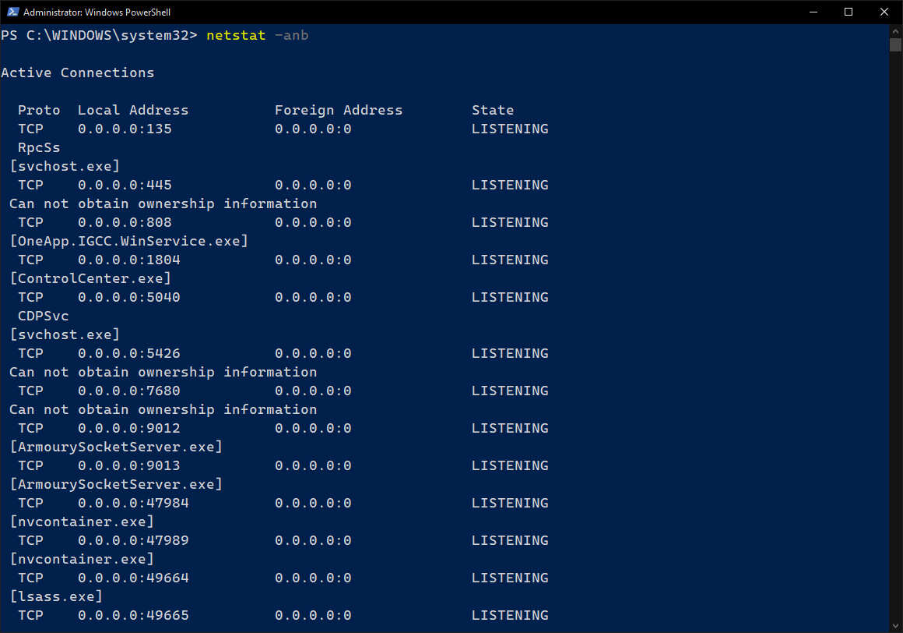

<h1>
  <span class="headline">Identifying Ports and Protocols of Software</span>
  <span class="subhead">Discover Ports and Protocols</span>
</h1>

**Learning objective:** By the end of this lesson, students will be able to identify ports and protocols associated with common software applications and explain their purposes in network communication.

## Ports and Protocols

So far, we've learned that network communication relies on ports and protocols. *Ports* serve as logical channels for software to communicate and exchange data; *protocols* define the exchange rules.

For this discussion, we'll help you continue familiarizing yourself with this idea by discovering which ports and protocols your favorite applications use.

> ❓ Why do you think some applications need specific ports to function?

## Discovering ports and protocols of a system's applications

Let's get familiar with the tools for this activity. They'll be different depending on your OS, so skip to the appropriate section below.

### macOS and Linux

Start by opening your terminal application.

In macOS and Linux, you can use the `lsof` command (this stands for **list open files**) to find network connections; here's an example:

```bash
lsof -i -P -n
```

Here's what the appended option flags mean:

- **`-i`**: List network connections only.
- **`-P`**: Show port numbers instead of names.
- **`-n`**: This option avoids DNS lookups for faster results.

You should see an output like the following:



Notice that you'll only see applications running with your user-level permissions. If you want to see the ports and protocols in use by applications running as the root (system) user, you can prepend that command with `sudo`:

```bash
sudo lsof -i -P -n
```

> 💡 If you're still curious about the `lsof` command, you can access the user manual by running `man lsof`.

### Windows

On Windows, launch the PowerShell app as the administrator. <span class="warning">Be sure to run Powershell as the administrator; the command we'll use doesn't work with user-level permissions.</span> With one of those apps launched, we can use the `netstat` command to find network connections:

```bash
netstat -anb
```

Here's a breakdown of the options we used:

- **`-a`**: Display all active connections.
- **`-n`**: Display addresses and port numbers numerically.
- **`-b`**: Show the executable using the connection.

You should see an output like the following:



> 💡 If you're still curious about the `netstat` command, you can access the user manual by running `netstat help`. This command also works on the Command Prompt!

<div class="activity solo-exercise">
  <h2 class="title">Analyze an application</h2>
  <span class="minutes">5 min</span>
</div>

Let's look at the ports and protocols used by the applications on our computers.

1. Choose an application to analyze: a web browser, a messaging app (like Slack or Discord), or another application.
2. Using the command we reviewed earlier, try to find the application's open port(s) and associated protocol (TCP/UDP).

<div class="activity discussion">
  <h2 class="title">What did you find?</h2>
  <span class="minutes">15 min</span>
</div>

Let's take a moment to reflect on our findings. We'll go around the room and take turns sharing the following:

1. Which application did you analyze?
2. What ports and protocols are your chosen application using?
3. Are the ports in the well-known range (0-1023), registered range (1024-49151), or dynamic range (49152-65535)?
4. Why do you think this application uses these ports?

## Wrap-up: independent exploration

Try identifying ports and protocols for other applications you use frequently, such as gaming platforms, video streaming services, or other applications.

Here are some suggestions:

1. Messaging apps like Discord or Slack
2. Video streaming apps like Zoom
3. A web browser like Chrome
4. Streaming music apps like Spotify
5. Online games
6. Apps you might not initially expect to connect to the internet

Once you're done, you can go through the questions we discussed earlier on your own to reflect on your findings.
