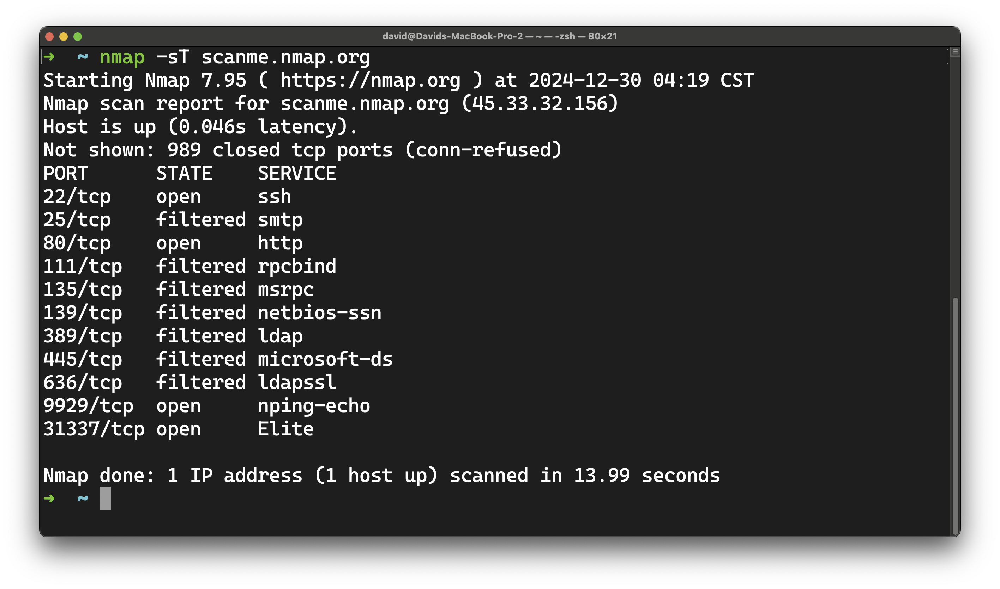
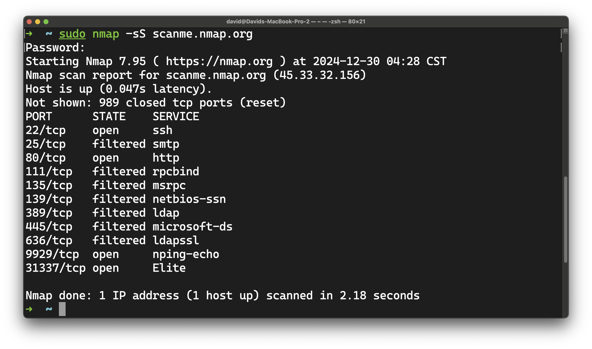
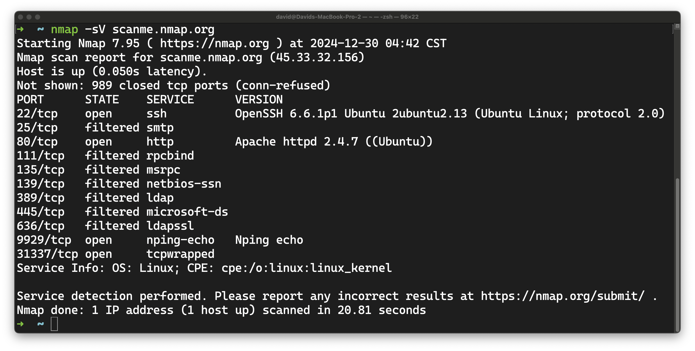
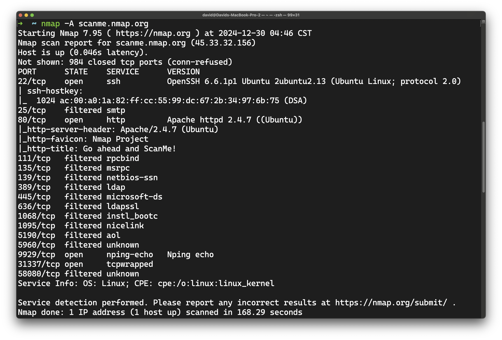

<h1>
  <span class="headline">Identifying Ports and Protocols of Software</span>
  <span class="subhead">Intro to Nmap</span>
</h1>

**Learning objective:** By the end of this lesson, students will be able to use Nmap to identify hosts and services on a network.

## Advanced network scanning with Nmap

[Nmap](https://nmap.org/) is an versatile open source tool used for to learn more about a local network and to discover security weaknesses. It can help you identify open ports, running services, and the protocols in use. Let's discuss how to get started with Nmap.

> ⚠️ Nmap is a powerful tool that can be used for both good and bad purposes. Make sure you have permission to scan the network you're targeting, and be aware that scanning a network without permission can be illegal.

## Installation

Nmap is available for Windows, Mac, and Linux. Skip to the relevant operating system below to install Nmap on your device.

### Windows

Navigate to the [Nmap download page](https://nmap.org/download.html#windows) and download the latest stable release. It will be labeled **Latest stable release self-installer:** and be followed by a link for `nmap-<version>-setup.exe`. Run the installer and follow the on-screen instructions use all the default selections provided.

Confirm the installation was successful by opening Command Prompt as the administrator and running `nmap --version`.

### Linux

To install Nmap, open your Terminal application. Then run the following command:

```bash
apt-get install nmap
```

After the installation is complete, you can confirm it worked by running `nmap --version` in the Terminal.

### macOS

To install Nmap, open your Terminal application, and run the following command:

```bash
brew install nmap
```

After the installation is complete, you can confirm it worked by running `nmap --version` in the Terminal.

## Running a simple scan

With your terminal app or command prompt open, you can run a simple scan on a host specifically set up by Nmap to run test scans. To do this, run the following command:

```bash
nmap -sT scanme.nmap.org
```

This command will scan the host `scanme.nmap.org` and provide you with a list of open and filtered TCP ports and the services running on them. You should see an output that looks similar to the following:



We can see a variety of services running on this host, including an SSH server on port 22, and an HTTP server on port 80.

Nmap has a variety of connection strategies we can use. The strategy we used above is a *Connect* scan, the simplest and most common type of scan. It's slow and likely to be detected by intrusion detection systems, so it's not the best choice for stealthy scans though. Faster and more technical scans are available, but may require administrator access on your system. Let's try one now - the command will change depending on your OS.

### Windows

As long as the Command Prompt is open as an administrator, you can run the following command:

```bash
nmap -sS scanme.nmap.org
```

### macOS and Linux

Use the following command in your Terminal:

```bash
sudo nmap -sS scanme.nmap.org
```

### Output

Regardless of your OS, you should see an output like this if you were able to use the command successfully:



This *SYN* scan, is a lot faster than the *Connect* scan, right? And we largely get the same information! It's also less likely to be detected by some intrusion detection systems because it doesn't complete a full TCP handshake.

## More advanced scans

We can perform more advanced scans that get more information about the target host.

### Service version detection

For example, the `-sV` flag will attempt to determine the version of the service running on the open port. It's aptly named the **service version** flag. This can be useful for identifying vulnerabilities in the software running on the host. Let's try it out:

```bash
nmap -sV scanme.nmap.org
```

You'll see an output like this:



Here we can see the version of the SSH server running on port 22 (OpenSSH v6.6.1p1 for Ubuntu), and the version of the HTTP server running on port 80 (Apache v2.4.7 for Ubuntu).

### Aggressive scan

An even more advanced scan can be done with the `-A` flag. This **agressive** scan enables OS detection, version detection, script scanning, and traceroute. Let's try it out:

```bash
nmap -A scanme.nmap.org
```

This scan will take much longer to complete (a few minutes), so grab a quick drink or stretch while you wait. When it's done you'll get a lot more information about the target host. You'll see an output like this:



This gets us even more detailed information about the services running on the host, like response scripts.

## Output options

You can add more flags to your Nmap command to get different types of output. For example, the `-oN` flag will output the scan results to a specified file in normal format. Let's try it out:

```bash
nmap -oN -sT scan.txt scanme.nmap.org
```

This will save the scan results to a file named `scan.txt` in the current directory. You can open the file in a text editor to view the results.

`scan.txt`

```plaintext
# Nmap 7.95 scan initiated Mon Dec 30 17:34:11 2024 as: nmap -sT -oN scan.txt scanme.nmap.org
Nmap scan report for scanme.nmap.org (45.33.32.156)
Host is up (0.045s latency).
Not shown: 984 closed tcp ports (conn-refused)
PORT      STATE    SERVICE
22/tcp    filtered ssh
25/tcp    filtered smtp
80/tcp    open     http
111/tcp   filtered rpcbind
135/tcp   filtered msrpc
139/tcp   filtered netbios-ssn
389/tcp   filtered ldap
427/tcp   filtered svrloc
445/tcp   filtered microsoft-ds
636/tcp   filtered ldapssl
1277/tcp  filtered miva-mqs
3211/tcp  filtered avsecuremgmt
3546/tcp  filtered unknown
4242/tcp  filtered vrml-multi-use
9929/tcp  open     nping-echo
31337/tcp open     Elite

# Nmap done at Mon Dec 30 17:34:22 2024 -- 1 IP address (1 host up) scanned in 11.13 seconds
```

This allows you to save the results of your scan for later review or to share with others.

You can also change the verbosity of the output with the `-v` flag. This will give you more detailed information about the scan as it runs. Let's try it out in combination with the `-sT` flag:

```bash
nmap -v -sT scan.txt scanme.nmap.org
```

This will output a lot more information about the scan as it runs, including the progress of the scan.

<div class="activity solo-exercise">
  <h2 class="title">Take Nmap for a spin</h2>
  <span class="minutes"></span>
</div>

Here's some additional exercises you can try to get more familiar with Nmap:

Using a network and devices you have permission to scan, try running some of the Nmap commands we've discussed in this lesson. Scan a device on your local network to see what services are running and what ports are open.

If you can, try scanning multiple types of devices - like a Windows machine, a Mac, and a Linux machine, or even a phone. You'll see that the results can vary based on the operating system and the services running on the device.

Start with the basic scan we ran at the beginning of the lesson, and then try some of the more advanced scans we discussed. Experiment with different flags and options to see how they affect the scan results.

Use the [Nmap documentation](https://nmap.org/docs.html) to learn more about additional flags and options you can use with Nmap.

If you're the owner of your network and all of the devices on it you could even try scanning the entire network to see what devices are connected and what services are running on them!

## Wrap up

As we've demonstrated, Nmap is a powerful tool for identifying hosts and services on a network. It can be used for a variety of purposes, from identifying security vulnerabilities to troubleshooting network issues. By learning how to use Nmap effectively, you can become a more effective network administrator and security professional.

Really want more? Check out the [Nmap Network Scanning book](https://nmap.org/book/) for a deep dive into the capabilities of Nmap.
